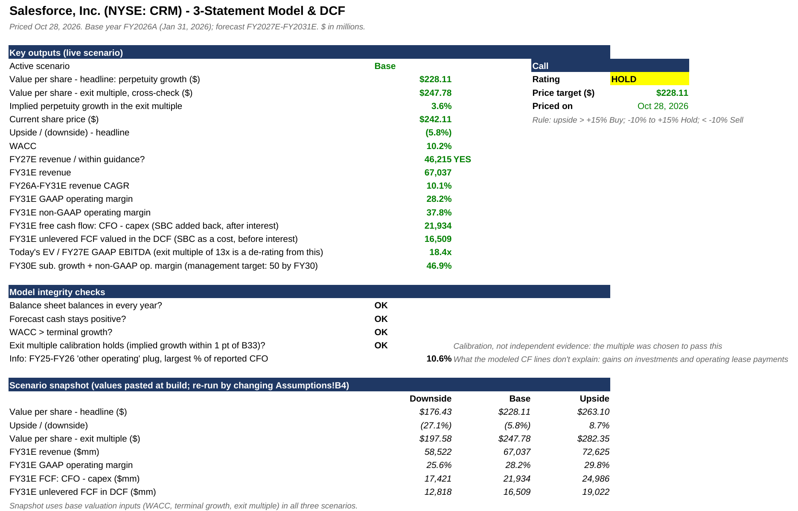

# Is Salesforce worth its share price?

> **Rating: Hold · Price target $228 · Price $242.11 on Oct 28, 2026 (NYSE close)**
>
> Two-page pitch: [docs/pitch.pdf](docs/pitch.pdf) · Educational project, not investment advice.

## Why I built this

In my master's I built a three-statement model and DCF for Coca-Cola by hand. For this project I switched roles: AI did the building and I acted as the auditor, on a harder company, a software business where deferred revenue, stock-based compensation and backlog drive the numbers. Salesforce made it a live question in 2026, with a $25B debt-funded buyback and a big bet on AI agents.

## The question and who it's for

**Is CRM fairly priced after its 2026 debt-funded buyback and AI bet?**

Written for a long-term portfolio manager deciding whether to own the stock.

## The answer

At $242.11, Salesforce is roughly fairly priced to slightly expensive: the base-case value is $228, 5.8% below the share price, so the call is **Hold** (rule: above +15% Buy, −10% to +15% Hold, below −10% Sell).

| | Downside | **Base** | Upside |
|---|---:|---:|---:|
| **Value per share (perpetuity growth, headline)** | $176.43 | **$228.11** | $263.10 |
| vs. share price ($242.11, Oct 28, 2026) | −27.1% | **−5.8%** | +8.7% |
| Cross-check: value per share at 13x exit EV/EBITDA | $197.58 | $247.78 | $282.35 |
| FY2031 revenue | $58.5B | **$67.0B** | $72.6B |
| FY2031 GAAP operating margin | 25.6% | **28.2%** | 29.8% |
| FY2031 unlevered FCF, valued in the DCF¹ | $12.8B | **$16.5B** | $19.0B |
| FY2031 free cash flow, CFO − capex² | $17.4B | **$21.9B** | $25.0B |

¹ Before interest, with stock-based compensation treated as a cost. This is the cash flow the DCF discounts.
² After interest, with stock-based compensation added back, the way companies usually report FCF. Shown for comparison only.

On Oct 29 software stocks sold off after ServiceNow's results and CRM traded near $231 intraday; at that price the gap is about −1%, still a Hold.



## Thesis

1. **Most of next year's revenue is already signed.** Salesforce ended FY26 with $72.4B of remaining performance obligations, $35.1B of it due within twelve months. That backlog lets the model build revenue from contracts rather than a growth guess.
2. **Reported profits rise as old deals finish amortizing.** About $1.9B a year of acquired-intangible amortization falls to roughly $0.5B by FY31. It is a non-cash charge, so as it runs off GAAP operating margin climbs from 20% to 28%.
3. **Agentforce is not in the base case.** Bookings growth fades from 12% to 8%. If agentic AI reaccelerates growth, that is upside the price target does not count on; the upside case ($263) shows roughly what it would take.

## Key debate: is stock-based compensation a real cost?

Salesforce pays about 8% of revenue (~$3.8B in FY27) in stock. Most sell-side models add it back to free cash flow because no cash leaves the company. This model does not: every share issued to employees is a smaller slice for existing owners, and buybacks partly exist to offset that dilution. The choice is worth about **$85 a share**: $228 with stock comp as a cost, about $313 if it is added back.

## Risks

1. **Debt-funded buyback.** Salesforce borrowed about $24.8B to buy back $25B of stock, taking total debt from $14.4B to $39.3B. Buying near today's price creates little value if the stock is worth about $228, and the debt now carries interest.
2. **Integrating Informatica.** It adds roughly 3 points to FY27 growth. If customers churn or the product loses ground, that growth fades while the amortization charges remain.
3. **The multiple shrinks as growth slows.** Growth slows from about 11% to 9%. The model already assumes EV/EBITDA falls from 18.4x today to 13x; a faster de-rating costs roughly $32 a share per 2x of multiple.

## Comps

What CRM would be worth at its peers' multiples. Oct 28, 2026 closes; analyst consensus from MarketScreener; NTM = next twelve months. P/E uses GAAP EPS for every company; CRM's FY27 excludes a one-off $2.43/share gain on strategic investments.

| Company | EV / NTM revenue | EV / NTM EBITDA | NTM P/E | NTM revenue growth |
|---|---:|---:|---:|---:|
| ServiceNow (NOW) | 8.2x | 21.6x | 68.5x | 19.3% |
| Oracle (ORCL) | 5.2x | 9.0x | 18.8x | 39.9% |
| Adobe (ADBE) | 3.4x | 7.1x | 11.8x | 9.3% |
| Workday (WDAY) | 4.2x | 12.1x | 33.7x | 10.7% |
| SAP (SAP) | 5.5x | 16.8x | 26.5x | 11.4% |
| **Peer median** | **5.2x** | **12.1x** | **26.5x** | **11.4%** |
| **Salesforce (CRM)** | **4.5x** | **11.3x** | **25.9x** | **10.1%** |
| *Microsoft (MSFT), reference only* | *9.3x* | *15.1x* | *25.3x* | *18.5%* |

| CRM value implied by | Peer median | Growth-matched peers (ADBE, WDAY, SAP) |
|---|---:|---:|
| EV / NTM revenue | $285.51 | $237.64 |
| EV / NTM EBITDA | $268.77 | $266.36 |
| NTM P/E | $247.38 | $224.04 |

**My DCF says $228; peer medians imply $247–$286.** Two reasons: peer EV multiples are built on EBITDA that excludes stock comp (with it added back the DCF gives $313), and faster growers (ServiceNow, Oracle) lift the median, while peers growing at Salesforce's pace imply $224–$266. ServiceNow fell 19–27% on Oct 29, which would pull the median down. Method and caveats: [docs/model-notes.md](docs/model-notes.md#comps-method).

## How I set it up

```
SEC filings ──► RPO revenue build ──► 3 statements ──► DCF ──► value per share
```

1. **Data:** income statement, balance sheet and cash flow from Salesforce's 8-K earnings releases (FY23–Q2 FY27), plus the latest balance sheet for net debt.
2. **Revenue:** next year's subscription revenue = this year-end's current RPO × a conversion ratio; current RPO grows by scenario.
3. **Costs:** each line a share of revenue on a GAAP basis, with acquisition amortization on its own schedule.
4. **Three statements:** linked so cash from the cash flow statement feeds the balance sheet, which balances every year.
5. **Valuation:** unlevered free cash flow discounted at a 10.2% WACC, perpetuity-growth terminal value, equity bridge to value per share, then the rating rule.

## Key decisions and why

| Decision | Why | Effect |
|---|---|---|
| Stock comp treated as a real cost | The dilution to shareholders is real | Adding it back raises base value to ~$313 |
| Perpetuity growth as the headline method | It values the same cash flow the model forecasts | Exit multiple at 13x gives $248 as a cross-check |
| 13x exit multiple, calibrated | Keeps implied growth near 3%; a de-rating from today's 18.4x, not taken from peers | Agreement between the two methods is by construction; see [notes](docs/model-notes.md#the-13x-exit-multiple-is-calibrated) |
| WACC from current rates | 4.99% 10-year Treasury (FRED), not an old 8% template | At 8% WACC the base value would be ~$336 |

## What I caught as the auditor

- The exit multiple was a 50/50 blend with 16x, which implied 4.9% growth forever. It was switched to perpetuity growth as the headline, with a calibrated 13x cross-check.
- Acquisition amortization was buried inside cost percentages, which hid its roll-off.
- A cash-flow tie-out check could never fail, so it was replaced with an honest disclosure of the plug.
- The working-capital plug was cut from 26.8% to 10.6% of CFO.

## What worked, what didn't

**Worked**
- The balance sheet balances to zero in every forecast year and every scenario.
- Management's FY27 guidance is reproduced: a 1.257x conversion of current RPO gives $46.2B revenue, inside the $46.1–46.4B range.

**Didn't**
- Undisclosed acquisitions (Contentful, Fin) are excluded because their prices haven't been published.
- The historical cash flow needs a plug to tie to reported operating cash flow: at most 10.6% of CFO in FY25–FY26, made up of gains on strategic investments and operating lease payments.

## What I'd do next

- **Earnings-update note after Q3 FY27** (expected early December 2026; Yahoo estimates Dec 2, not yet confirmed by Salesforce): what beat or missed, three takeaways, and whether the rating changes.
- **Refresh the comps each quarter** at a single price date.

## Run it

```bash
pip install -r requirements.txt
python scripts/build_model.py   # rebuild the workbook
python scripts/comps.py         # comps table and implied values
python scripts/pitch.py         # two-page pitch PDF (after the workbook has been recalculated)
```

## Repository contents

```
model/Salesforce_CRM_Model.xlsx   The model (open in Excel)
scripts/build_model.py            Rebuilds the workbook from scratch with openpyxl
scripts/comps.py                  Computes the trading comps and implied values
scripts/pitch.py                  Builds the two-page pitch PDF from the model and comps
data/comps_inputs.csv             Comps inputs: Oct 28 prices, consensus estimates, sources
data/comps.csv                    Comps output: multiples, growth, margins
docs/pitch.pdf                    Two-page equity pitch
docs/model-notes.md               Technical detail: calibration, margins, all judgment calls, tabs, updating, changelog
docs/project-explained.md         Plain-English explanation for non-finance readers
docs/images/                      Screenshots of the Cover and DCF tabs; valuation-range chart
```

**Details:** [docs/model-notes.md](docs/model-notes.md) · **Plain English:** [docs/project-explained.md](docs/project-explained.md)

## Sources

- [Salesforce Q4 FY26 earnings release, 8-K Ex. 99.1 (Feb 25, 2026)](https://www.sec.gov/Archives/edgar/data/1108524/000110852426000056/crm-q4fy26xexhibit991.htm)
- [Salesforce Q4 FY24 earnings release, 8-K Ex. 99.1 (Feb 28, 2024)](https://www.sec.gov/Archives/edgar/data/1108524/000110852424000002/crm-q4fy24xexhibit991.htm)
- [Salesforce Q2 FY27 earnings release (Aug 26, 2026)](https://investor.salesforce.com/files/doc_financials/2027/q2/CRM-Q2-FY27-Earnings-Press-Release.pdf)
- [Salesforce FY30 target and "50 by FY30" framework (Oct 15, 2025)](https://investor.salesforce.com/news/news-details/2025/Salesforce-Announces-New-FY30-Revenue-Target-of-60B-10-Organic-FY26-FY30-CAGR/)
- Share price: $242.11 NYSE close, Oct 28, 2026 ([Motley Fool quote](https://www.fool.com/quote/nyse/crm/); [Trefis, Oct 29](https://www.trefis.com/stock/crm/articles/621321/can-you-still-buy-salesforce-stock-today/2026-10-29))
- Beta 1.26: Yahoo Finance "Beta (5Y monthly)", monthly returns vs the S&P 500; cross-checked with stockanalysis.com "Beta (5Y)"
- [10-year Treasury yield: FRED series DGS10](https://fred.stlouisfed.org/series/dgs10), 4.99% on Oct 27, 2026
- Comps: MarketScreener consensus estimates (snapshot dates in `data/comps_inputs.csv`); Oct 28 closes from Motley Fool, boerse.de (SAP, Xetra) and stockanalysis.com (MSFT)
- [Oct 29 software selloff after ServiceNow results (24/7 Wall St.)](https://247wallst.com/investing/2026/10/29/servicenow-tumbles-19-as-slower-contract-growth-overshadows-raised-ai-target-salesforce-slides-6-workday-drops-5)
