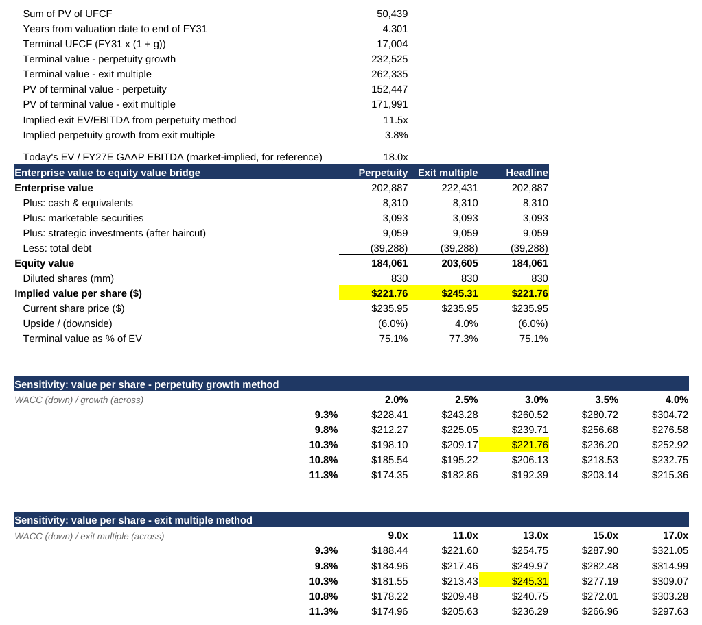

# Model notes

Technical detail behind the [README](../README.md). For a non-finance explanation, see [project-explained.md](project-explained.md).

## Contents

- [The 13x exit multiple is calibrated](#the-13x-exit-multiple-is-calibrated)
- [Margin path vs management's targets](#margin-path-vs-managements-targets)
- [All judgment calls](#all-judgment-calls)
- [Comps method](#comps-method)
- [Workbook tabs](#workbook-tabs)
- [Rebuilding](#rebuilding)
- [Updating the model](#updating-the-model)
- [Changelog](#changelog)

## The 13x exit multiple is calibrated

The headline value uses perpetuity growth of 3.0%. A 13x exit EV/EBITDA multiple is shown as a cross-check, but it is **calibrated, not independent**: it was set so its implied perpetual growth (3.6%) stays close to the 3% assumption, so the two methods agreeing is by construction.

What it does tell you: holding today's 18.4x FY27E GAAP EBITDA multiple into FY31 would require far more growth than the model assumes. The cross-check therefore assumes a de-rating from 18x to 13x as revenue growth slows from ~11% to ~9%. The multiple is on GAAP EBITDA, which counts stock comp as a cost; 13x GAAP is ~10x on adjusted EBITDA. Each 2x turn moves the cross-check by about $32 a share.

The Cover tab checks that the calibration holds in every scenario (implied growth within 1 point of the perpetuity rate). That check can fail, but because the multiple was chosen to pass it, it confirms consistency, not correctness.



## Margin path vs management's targets

The base case assumes about **4 points of non-GAAP operating margin expansion** (34.0% in FY26 to 37.8% in FY31), from ~50 bp a year of sales & marketing efficiency. GAAP margin rises faster (20.1% to 28.2%) because amortization of acquired intangibles rolls off from $1.9B to $0.5B.

Management's own yardstick is its "50 by FY30" framework: subscription & support growth (constant currency) plus non-GAAP operating margin should total 50 by the end of FY30 ([Oct 2025 investor day](https://investor.salesforce.com/news/news-details/2025/Salesforce-Announces-New-FY30-Revenue-Target-of-60B-10-Organic-FY26-FY30-CAGR/)). The model's FY30 score is **46.9** (10.0% growth + 36.9% margin; reported rather than constant-currency growth), so the base case is more conservative than management's target. FY30 revenue in the model is $61.7B including Informatica, against management's $60B+ target excluding it.

## All judgment calls

The README keeps the four that move the answer most. The full list:

| Choice | Why | Effect |
|---|---|---|
| Stock comp treated as a real cost | The dilution to shareholders is real | Adding it back raises base value to ~$313 |
| Perpetuity growth as the headline method | It values the same cash flow the model forecasts | Exit multiple at 13x gives $248 as a cross-check; at 16x it would give $296 but imply 4.8% growth forever |
| 13x exit multiple, calibrated | Keeps implied growth near 3%, i.e. a de-rating from today's 18.4x as growth slows; not taken from peers | Each 2x turn moves the cross-check by about $32 a share |
| WACC built from a 4.99% 10-year Treasury | Reflects current rates, not an old 8% template | At 8% WACC the base value would be ~$336 |
| Margins expand in the base case | Sales & marketing efficiency plus amortization roll-off | Non-GAAP 34.0% → 37.8%; GAAP 20.1% → 28.2% |
| Amortization modeled on its own schedule | Otherwise its roll-off becomes a hidden cash cost | FY31 unlevered FCF ~$1.7B higher than with amortization inside the cost percentages |
| Finance-lease costs kept inside operating costs | Simpler than splitting into depreciation plus financing-line principal; treats them as if paid in cash | Slightly conservative versus the company's own FCF definition |
| Undisclosed acquisitions excluded | Contentful and Fin prices not yet public | Will be added when disclosed |
| ASR final settlement not yet reflected | Not reported as of Oct 28; 823M basic shares after the initial delivery | Any extra shares delivered at settlement would lift value per share slightly |
| Debt assumed to refinance | Keeps the model simple | Cash builds to ~$48B by FY31 |

## Comps method

- **Prices:** Oct 28, 2026 closes for every company.
- **Estimates:** analyst consensus from MarketScreener valuation pages. Snapshot dates range from Sep 22 to Oct 28, 2026 and are listed in `data/comps_inputs.csv`.
- **NTM:** each company's fiscal years blended by the months remaining: NTM = (m/12) × current FY + (1 − m/12) × next FY. Revenue growth compares NTM with LTM built the same way.
- **EV:** share price × shares (market cap ÷ reference price on the MarketScreener page) + the page's net debt for the current fiscal year.
- **Implied CRM value:** peer multiple × CRM's NTM metric, then the DCF's equity bridge (cash, securities, 80% of strategic investments, less debt) over 830M diluted shares, so comps and DCF differ only in enterprise value.
- **Peer set:** ServiceNow, Oracle, Adobe, Workday, SAP. Microsoft is a reference row only and is excluded from the median. "Growth-matched" peers are those whose NTM revenue growth is within 2 points of CRM's (Adobe, Workday, SAP).
- **Caveats:** consensus EBITDA is analysts' adjusted EBITDA, which excludes stock comp. EPS bases differ by company, so P/E is the least reliable multiple. ServiceNow reported after the Oct 28 close and fell 19–27% on Oct 29, which would lower its multiples and the peer median.

## Workbook tabs

| Tab | What it holds |
|---|---|
| **Cover** | Key outputs; the call (rating, price target, pricing date); integrity checks (balance sheet, positive cash, WACC > growth, exit-multiple calibration); today's market multiple; FY30 "growth + margin" score; the historical cash-flow plug; scenario snapshot; how-to |
| **Assumptions** | All forecast drivers. Scenario switch in cell `B4` (1 Downside, 2 Base, 3 Upside) |
| **Revenue Build** | RPO-driven revenue engine, billings, FY27 guidance check |
| **IS / BS / CF** | Income statement, balance sheet (with balance check), cash flow statement |
| **DCF** | WACC, unlevered FCF, terminal value, equity bridge, two sensitivity tables |
| **Sources** | Where every historical number comes from |

Colour code: **blue** = hardcoded input · **black** = formula · **green** = link to another sheet · **yellow** = key lever.

## Rebuilding

```bash
pip install -r requirements.txt
python scripts/build_model.py   # workbook (formulas, not values; Excel calculates on open)
python scripts/comps.py         # comps table and implied values
```

## Updating the model

- **Before publishing a call:** refresh the share price (`DCF!B6`), the valuation date (`DCF!B5`) and the risk-free rate (`DCF!B19`), then re-check the rating on the Cover tab. Refresh `price_oct28` in `data/comps_inputs.csv` to the same date and rerun `scripts/comps.py`.
- **After each earnings release:** update the latest balance sheet inputs on the `DCF` tab (cash, investments, debt, basic shares in `B7`), then write an earnings-update note in `docs/`.
- **Your own view:** change base-case current RPO growth for FY28–FY31 on `Assumptions` row 11. FY27 is anchored to guidance.

## Changelog

- **Call and comps (Oct 29, 2026).** Repriced at the Oct 28 close ($242.11) with the 10-year at 4.99%; base value $228.11 (was $221.76, mainly the lower risk-free rate). Added the rating rule and call (Hold, price target $228), trading comps against five peers with Microsoft as reference, and the thesis, key debate and risks. README restructured story-first; technical detail moved here.
- **Second review (Oct 15, 2026).** 13x exit multiple disclosed as calibrated, with today's market multiple shown for context; margin path compared with management's "50 by FY30" target; historical working-capital lines filled from the reported cash flow statements (FY25–FY26 plug now max 10.6% of CFO, was 26.8%); screenshots added.
- **Model review (Oct 15, 2026).** Amortization of acquired intangibles moved out of the cost percentages so its roll-off raises operating income; headline switched to perpetuity growth with a 13x exit multiple as a cross-check (was a 50/50 blend with 16x, which implied 4.9% growth forever); both FCF definitions labeled; lease wording corrected; the cash-flow tie-out check (which could not fail) replaced by a plug-size disclosure; 10-year yield re-sourced to FRED and beta to a named 5-year monthly window. Base value moved from $230.36 to $221.76.
